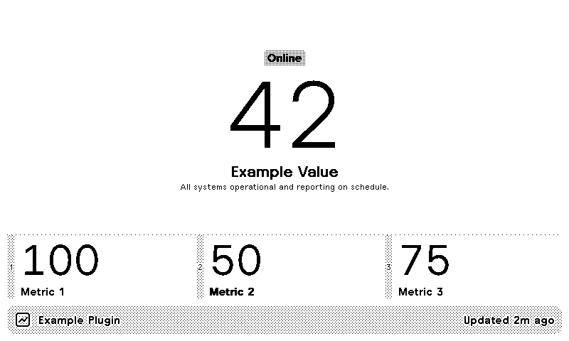
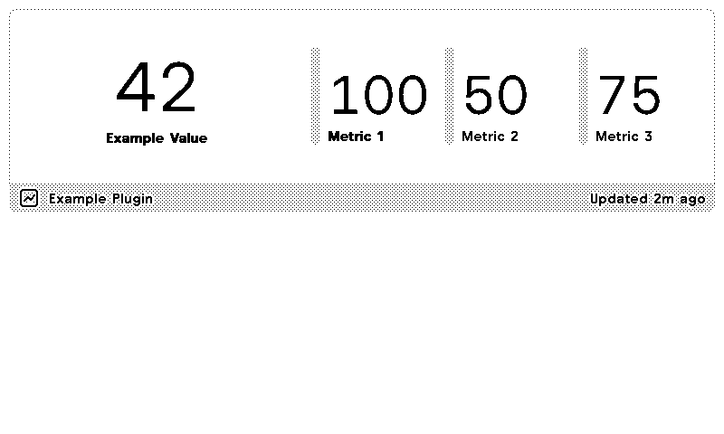
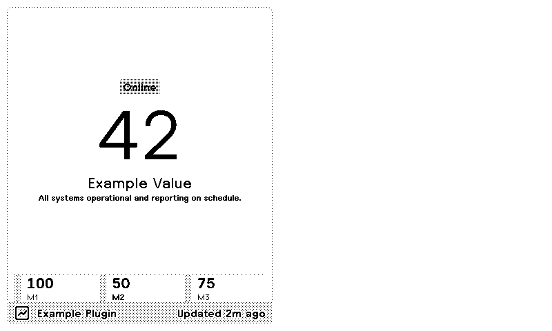
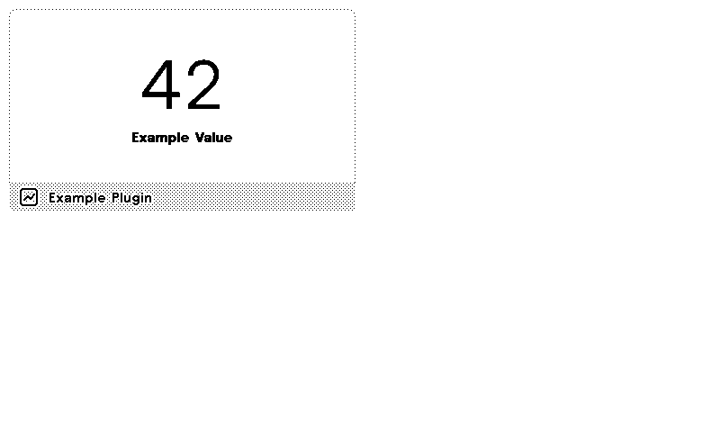

# TRMNL Plugin Template

A complete, production-ready starter template for building custom Private Plugins and Recipes for [TRMNL](https://trmnl.com) ePaper devices — powered by **[TRMNL Framework 3.4](https://trmnl.com/framework/docs/3.4)**, **[`trmnlp`](https://github.com/usetrmnl/trmnlp)** local preview & headless browser testing, and **[`trmnl-agent-skills`](https://github.com/usetrmnl/trmnl-agent-skills)** for autonomous AI coding agents.

## 🚀 Quick Start

### Prerequisites

- **Docker** (recommended — zero Ruby setup needed via [`bin/trmnlp`](bin/trmnlp)) **or** Ruby 4.0+ (`gem install trmnl_preview`)
- Understanding of [TRMNL Framework 3.4](https://trmnl.com/framework/docs/3.4)
- Familiarity with [Liquid 101](https://help.trmnl.com/en/articles/10671186-liquid-101), [Advanced Liquid](https://help.trmnl.com/en/articles/10693981-advanced-liquid), and [TRMNL Custom Filters](https://help.trmnl.com/en/articles/10347358-custom-plugin-filters)
- TRMNL account with Developer Edition add-on or BYOD license (see [Private Plugins Guide](https://help.trmnl.com/en/articles/9510536-private-plugins))

### Getting Started

1. **Clone this repository**:
   ```bash
   git clone https://github.com/your-username/your-plugin-name.git
   cd your-plugin-name
   ```

2. **Start the local live-reload preview server**:
   ```bash
   ./bin/trmnlp serve
   # Open http://localhost:4567 to preview Full, Half Horizontal, Half Vertical, and Quadrant views
   ```

3. **Customize the configuration and template files**:
   - Update [`src/settings.yml`](src/settings.yml) with your plugin strategy, polling URL, and `custom_fields`
   - Reference [`custom-fields.yml`](custom-fields.yml) for all supported [Custom Form Builder](https://help.trmnl.com/en/articles/10513740-custom-plugin-form-builder) field types
   - Update [`.trmnlp.yml`](.trmnlp.yml) with local mock `custom_fields` and `variables`
   - Edit the 5 Liquid templates in [`src/`](src/) (`full`, `half_horizontal`, `half_vertical`, `quadrant`, `shared`)

4. **Lint, Test, and Render Screenshots Locally**:
   ```bash
   ./bin/trmnlp lint                  # Static validation (settings.yml, Liquid syntax, Framework rules)
   ./bin/trmnlp test --report report  # Headless browser RSpec tests (overflow, dark mode, all devices & views)
   ./bin/trmnlp build --png           # Render static HTML + PNG screenshots into _build/
   ```

## 📁 Project Structure

```text
your-plugin-name/
├── .claude/
│   ├── settings.json                     # Auto-enables trmnl@trmnl-agent-skills in Claude Code
│   └── skills/trmnl/                     # Bundled usetrmnl/trmnl-agent-skills (SKILL.md + verbatim refs)
├── .github/
│   ├── instructions/
│   │   └── trmnl.instructions.md         # GitHub Copilot TRMNL skill instructions
│   ├── workflows/
│   │   └── trmnl.yml                     # CI workflow running `trmnlp lint` and `trmnlp test`
│   ├── copilot-instructions.md           # Project-specific AI assistant instructions
│   └── TEMPLATE_USAGE.md                 # Instructions for customizing the template
├── assets/
│   └── demo/                             # Demo preview screenshots & sample-data.json
├── bin/
│   └── trmnlp                            # Official CLI wrapper (local gem or trmnl/trmnlp Docker image)
├── src/
│   ├── settings.yml                      # Official TRMNL plugin settings & custom_fields
│   ├── shared.liquid                     # Shared variables, inline SVG logo, reusable partials
│   ├── full.liquid                       # Full-screen layout (800×480 OG / 1040×780 X)
│   ├── half_horizontal.liquid            # Top or bottom half of a 1Tx1B mashup (800×240)
│   ├── half_vertical.liquid              # Left or right half of a 1Lx1R mashup (400×480)
│   ├── quadrant.liquid                   # Quarter-size 2×2 mashup layout (400×240)
│   ├── transform.js.example              # Optional JavaScript payload transform template
│   └── transform.py.example              # Optional Python serverless transform template
├── tests/
│   └── plugin_spec.rb                    # RSpec headless browser tests (`it_behaves_like 'a publishable recipe'`)
├── .trmnlp.yml                           # Local preview configuration & mock variables
├── AGENTS.md                             # AI agent guide (Codex, Gemini, Cursor, Claude Code, OpenCode)
├── custom-fields.yml                     # Form Builder YAML reference & examples
├── GETTING_STARTED.md                    # Step-by-step developer guide
├── CONTRIBUTING.md                       # Contribution guidelines
├── LICENSE                               # MIT License
└── README.md                             # This file
```

## 🤖 AI Agent Skills & Autonomous Local Workflow

This template comes pre-configured with **[`usetrmnl/trmnl-agent-skills`](https://github.com/usetrmnl/trmnl-agent-skills)** and **[`usetrmnl/trmnlp`](https://github.com/usetrmnl/trmnlp)** across all major AI coding assistants:

| AI Harness | Included Configuration |
|---|---|
| **Claude Code / OpenCode** | [`.claude/settings.json`](.claude/settings.json) + [`.claude/skills/trmnl/SKILL.md`](.claude/skills/trmnl/SKILL.md) |
| **GitHub Copilot** | [`.github/instructions/trmnl.instructions.md`](.github/instructions/trmnl.instructions.md) + [`.github/copilot-instructions.md`](.github/copilot-instructions.md) |
| **OpenAI Codex / Gemini / Cursor / Antigravity** | [`AGENTS.md`](AGENTS.md) + bundled references in [`.claude/skills/trmnl/references/`](.claude/skills/trmnl/references/) |

AI agents can autonomously write markup, validate it, render real headless browser screenshots, and check for overflow or clipped text without needing physical hardware:

```bash
./bin/trmnlp lint --format json    # Structured JSON lint diagnostics for agents
./bin/trmnlp test --report report  # Headless browser checks across OG (800×480) and X (1040×780), portrait, dark mode, and API errors
./bin/trmnlp build --png           # Render HTML & PNG snapshots in _build/
```

## 🎨 Template Files & View Adaptation Strategy

| File | Viewport (OG) | Usable Height | Mashup Slot | Layout Strategy |
|------|---------------|---------------|-------------|-----------------|
| [`src/shared.liquid`](src/shared.liquid) | Shared | — | Runs before every view | Defines shared variables, localized timestamps, inline base64 SVG logo, and `` partials |
| [`src/full.liquid`](src/full.liquid) | `800×480` | `~320px` | Full screen | **The Canvas**: Hero value + status badge + 3-column metric grid |
| [`src/half_horizontal.liquid`](src/half_horizontal.liquid) | `800×240` | `~144px` | Top/Bottom (`1Tx1B`) | **The Banner**: Wide and shallow — columnizes content horizontally via 12-col `grid` (`col--span-5` + `col--span-7`) |
| [`src/half_vertical.liquid`](src/half_vertical.liquid) | `400×480` | `~368px` | Left/Right (`1Lx1R`) | **The Column**: Narrow and tall — stacks sections vertically with `layout--col` |
| [`src/quadrant.liquid`](src/quadrant.liquid) | `400×240` | `~144px` | Quarter (`2×2` / `3×3`) | **The Postcard**: Displays the single most important metric cleanly |

### Layout Previews

| Full Layout | Half Horizontal |
|---|---|
|  |  |
| **Half Vertical** | **Quadrant** |
|  |  |

## ⚙️ Configuration (`src/settings.yml` & `custom-fields.yml`)

### [`src/settings.yml`](src/settings.yml)

Follows the official [Importing & Exporting Private Plugins](https://help.trmnl.com/en/articles/10542599-importing-and-exporting-private-plugins) and [`trmnlp`](https://github.com/usetrmnl/trmnlp) specification:

```yaml
name: Example Plugin
description: Template plugin for TRMNL devices
framework_version: "3.4.0"
strategy: polling                  # polling | webhook | plugin_merge | static | async_polling | none
refresh_interval: 15               # minutes: 15 | 30 | 60 | 180 | 360 | 720 | 1440
polling_url: "https://trmnl.com/custom_plugin_example_data.json"
polling_verb: GET                  # GET | POST
polling_headers: ""                # Name: Value or name=value (one per line; supports {{ field }} interpolation)
polling_body: ""                   # Optional JSON payload for POST requests
no_screen_padding: 'no'            # 'no' | 'yes' (removes bleed margin)
dark_mode: 'no'                    # 'no' | 'yes'
custom_fields:
  - keyname: about
    name: About This Plugin
    field_type: author_bio
    category: productivity,utilities
    description: A starter template plugin built on TRMNL Framework 3.4.
    github_url: https://github.com/hossain-khan/trmnl-plugin-template
```

### Data Strategies ([Docs](https://help.trmnl.com/en/articles/17434705-plugin-strategies))
- **`polling`**: TRMNL fetches 1 or more newline-separated URLs (JSON, XML, RSS, CSV, plain text). Single URL merges at root (`{{ value }}`); multiple URLs merge under `{{ IDX_0.field }}`, `{{ IDX_1.field }}`.
- **`webhook`**: Your service POSTs `{"merge_variables": {...}}` to TRMNL's webhook URL (max 5KB stored payload, or 10KB on TRMNL+; supports `merge_strategy: "deep_merge"` or `"stream"`).
- **`plugin_merge`**: Combines data already fetched by other plugins on your TRMNL account.
- **`static`**: Renders hardcoded JSON from `static_data`.
- **`async_polling`**: Server responds HTTP 202 immediately, then POSTs `{"merge_variables": {...}}` to `{{ callback_url }}` within 15 minutes.
- **`none`**: Uses only `trmnl.*` globals or client-side JavaScript.

### Custom Form Fields ([Docs](https://help.trmnl.com/en/articles/10513740-custom-plugin-form-builder))
Defined under `custom_fields:` in [`src/settings.yml`](src/settings.yml) (with extended examples in [`custom-fields.yml`](custom-fields.yml)):

```yaml
- keyname: show_details
  field_type: boolean
  name: Show Additional Details
  description: Display secondary metrics in the layout
  default: true
  optional: true

- keyname: custom_title
  field_type: string
  name: Custom Plugin Title
  description: Leave blank to use the plugin instance name
  placeholder: Example Plugin
  optional: true
```

- **In Liquid templates**: `{{ trmnl.plugin_settings.custom_fields_values.custom_title }}`
- **In Polling URL / Headers / Body**: `https://api.example.com/data?key={{ api_key | url_encode }}`

## ✨ TRMNL Framework 3.4 Highlights

- **Zero Inline Styles & Zero Emojis**: Templates strictly use Framework 3.4 classes (no `style="..."` and no emojis, which render as missing glyph boxes on ePaper hardware).
- **14-Step Linear Grayscale & Chromatic Palette**:
  - Grayscale: `bg--gray-10` through `bg--gray-75` (in steps of 5), `text--gray-*`, `label--gray`, and shade-step borders `border--h-10` through `border--h-75`.
  - Chromatic & Semantic Roles: 10 hues (`red`, `orange`, `yellow`, `lime`, `green`, `cyan`, `blue`, `violet`, `purple`, `pink`) and semantic classes (`label--primary`, `label--success`, `label--warning`, `label--error`) with automatic perceptual grayscale fallback on 1-bit/2-bit/4-bit displays.
- **Theme-Ready & Adaptive Icons**:
  - Uses `image--adaptive` on monochrome SVG icons so they recolor automatically for Dark Mode and v3 Themes (`Black and Yellow`, `White and Red`, `Dark`).
  - Uses `inverse` (`<div class="item inverse">`) to invert cards/items cleanly across all devices and themes.
- **Adaptive Charts (`TRMNLCharts`), Maps (`TRMNLMaps`), and `TRMNLPaint`**:
  - Runtime helpers automatically style Highcharts and MapLibre GL JS vector maps using live screen tokens.

## 🔧 Advanced Liquid & Custom Filters

From [Advanced Liquid](https://help.trmnl.com/en/articles/10693981-advanced-liquid) and [Custom Plugin Filters](https://help.trmnl.com/en/articles/10347358-custom-plugin-filters):

```liquid
<!-- Convert UTC timestamp to user's local timezone -->
{{ timestamp | date: "%s" | plus: trmnl.user.utc_offset | date: "%H:%M" }}

<!-- Localized "Updated at" string using l_word and utc_offset -->
{{ 'updated' | l_word: trmnl.user.locale }} {{ "now" | date: "%s" | plus: trmnl.user.utc_offset | date: "%H:%M" }}

<!-- Localized date formatting -->
{{ '2025-01-11' | l_date: '%y %b', trmnl.user.locale }}

<!-- Random numbers & array sampling -->

{{ "a,b,c" | split: "," | sample }}

<!-- Unique DOM IDs for Mashup-safe JS / Charts -->


<!-- Serialize objects for JavaScript -->
<script>
  document.addEventListener("DOMContentLoaded", function() {
    const payload = {{ data_object | json }};
  });
</script>
```

## 📚 Official TRMNL Resources

- [TRMNL Framework 3.4 Docs](https://trmnl.com/framework/docs/3.4) — Complete design system reference
- [Private Plugins Guide](https://help.trmnl.com/en/articles/9510536-private-plugins) — Building private plugins
- [Plugin Strategies](https://help.trmnl.com/en/articles/17434705-plugin-strategies) — Polling, Webhook, Plugin Merge, Static, Async Polling
- [Custom Plugin Form Builder](https://help.trmnl.com/en/articles/10513740-custom-plugin-form-builder) — User-facing YAML configuration fields
- [Advanced Liquid](https://help.trmnl.com/en/articles/10693981-advanced-liquid) & [Custom Plugin Filters](https://help.trmnl.com/en/articles/10347358-custom-plugin-filters) — Timezones, localization, JS mixing, custom filters
- [Importing & Exporting Private Plugins](https://help.trmnl.com/en/articles/10542599-importing-and-exporting-private-plugins) — ZIP archive specification
- [GitHub Sync](https://help.trmnl.com/en/articles/15977899-github-sync) & [`trmnlp` Local Dev Server](https://github.com/usetrmnl/trmnlp) — Version control, local preview, `trmnlp lint`, and `trmnlp test`
- [TRMNL CLI](https://help.trmnl.com/en/articles/17226209-trmnl-cli) & [TRMNL Agent Skills](https://github.com/usetrmnl/trmnl-agent-skills) — Terminal management & AI agent references
- [TRMNL Server IPs](https://trmnl.com/api/ips) — IP whitelist for self-hosted polling endpoints

## 📄 License

This template is provided under the MIT License — see [LICENSE](LICENSE) for details.
